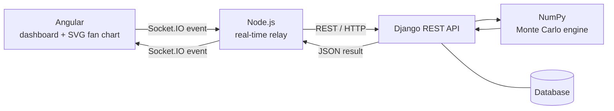

<div align="center">

# 🔮 FinTwin

### Don't just track your money. Stress-test it.

A digital twin of your personal finances that simulates job loss, medical bills, cost hikes and market crashes, and shows you the *range* of futures that could follow.


</div>

---

## 💡 The idea

Most finance apps answer one question: **"What happened to my money?"**

FinTwin tries to answer a different one: **"What could happen to my finances if something changes?"**

You enter your income, expenses, savings and debt. FinTwin turns that into a virtual copy of your finances (the *twin*). Then you hit it with a shock, such as *"my income stops for 6 months"*, and it runs a **Monte Carlo simulation**: hundreds of slightly different possible futures, drawn together as a **fan chart**.

> We are **not** predicting what *will* happen. We are showing what *could* happen under a given scenario, so people can prepare before a crisis, not after.

### Why this exists

A fresher losing a job is hard. Someone with EMIs, school fees, medical costs and a household to run faces a much bigger problem. Work is changing, and income feels less predictable than it used to. Being able to see the impact *in advance* is useful.

---

## ✨ What FinTwin does

- 🧬 **Builds a digital twin** of a user's financial profile (income, expenses, savings, debt)
- ⚡ **Applies shock scenarios** to the twin, not to the real data
- 🎲 **Runs a Monte Carlo simulation** (500 futures over 24 months)
- 📈 **Draws a fan chart** where each line is one possible future
- 🚨 **Shows risk**: probability of going below zero, and when it typically happens
- 🔁 **Keeps the twin in sync** when the user updates their profile

### Planned scenarios

All four use the **same engine**. Only the parameters change.

| Scenario | What changes in the simulation |
|---|---|
| 💼 Job Loss | Income drops (to 0 or a % of normal) for N months, then resumes |
| 🏥 Medical Emergency | One-time lump-sum expense |
| 🏠 Rent / Cost-of-Living Hike | Monthly expenses rise by a % from the shock point |
| 📉 Market Crash / Investment Loss | One-time % cut to savings/investments |

---

## 🧠 How the simulation works

Real life is noisy. Nobody spends exactly the same amount every month. So instead of one calculation, FinTwin runs many:

1. Start from the user's savings.
2. Each month, randomize expenses with a **Normal distribution** (mean = 1.0×, std dev = 0.1×).
3. Apply the shock (for example, income = 0 for the first 6 months).
4. Record the balance. Repeat for **24 months**.
5. Repeat the whole thing **500 times**.

The result is a 500 × 24 grid of balances: 500 possible futures. The early months are tightly packed; later months spread out because small random changes add up. That spread is the **fan** in the fan chart.

```python
import numpy as np

def monte_carlo(income, expenses, savings, shock_months=6, n_sims=500, months=24):
    paths = np.zeros((n_sims, months))
    for i in range(n_sims):
        balance = savings
        for m in range(months):
            monthly_expense = expenses * np.random.normal(1, 0.1)
            monthly_income = 0 if m < shock_months else income
            balance += monthly_income - monthly_expense
            paths[i, m] = balance
    return paths  # shape: (500, 24)
```

> ⚠️ **Honest limits:** the variation is a simplified assumption, not calibrated against real economic data. Outputs are *illustrative ranges*, not financial advice.

---

## 🏗️ Architecture



**Flow:** `Angular → Node.js → Django → NumPy → Django → Node.js → Angular`

| Layer | Job | What it does *not* do |
|---|---|---|
| **Angular** | UI, forms, scenario picker, fan chart | No simulation maths |
| **Node.js + Socket.IO** | Real-time relay between browser and backend | **Does not run the simulation** |
| **Django REST** | API, data models, calls the engine, stores results | No real-time delivery |
| **NumPy** | Monte Carlo computation | Nothing else |

Why three layers? Each does one job: Python is best for the numerical work, Node for live updates, Angular for a structured UI.

### Planned socket events

| Event | Direction | Payload |
|---|---|---|
| `update_profile` | Angular → Node | `{ userId, income, expenses, savings, debt }` |
| `twin_updated` | Node → Angular | `{ status, timestamp }` |
| `run_simulation` | Angular → Node | `{ userId, scenario, severity }` |
| `simulation_progress` | Node → Angular | `{ percent }` *(optional)* |
| `simulation_result` | Node → Angular | `{ paths, stats }` |

Results are emitted only to the **requesting client**, not broadcast to everyone.

---

## 🧰 Tech stack

| Area | Tools |
|---|---|
| Frontend | Angular, socket.io-client, custom SVG fan chart |
| Real-time layer | Node.js, Express, Socket.IO, Axios, CORS, dotenv |
| Backend | Django, Django REST Framework |
| Simulation | Python, NumPy (Pandas optional for summaries) |
| Database | SQLite for development, PostgreSQL optional |
| Optional later | Celery + Redis (background jobs), JWT auth |

---

## 🚦 Project status

> **Current progress: core simulation logic implemented; full-stack integration in progress.**

- [x] Monte Carlo simulation logic (standalone Python/NumPy)
- [x] Django REST endpoint for simulation
- [x] Django models (simulation runs, saved per user)
- [x] Node.js Socket.IO server
- [x] Node ↔ Django integration (Axios)
- [x] Angular profile form
- [x] Angular scenario picker
- [x] Fan chart component (drawn with SVG for now)
- [x] Results view (survival time, risk probability)
- [x] Authentication (optional sign-in, or continue as a guest)

---

## 📁 Planned structure

```
fintwin/
├── client/          # Angular app (forms, scenario picker, SVG fan chart)
├── node-server/     # Express + Socket.IO relay
│   ├── server.js
│   ├── socketHandlers.js
│   └── djangoClient.js
├── backend/         # Django project + DRF API + simulation engine
├── docs/            # diagrams, screenshots, report
└── README.md
```

---

## 🚀 Getting started

> You need Node.js 18+, Python 3.10+ and the Angular CLI (`npm i -g @angular/cli`). Open three terminals.

**Terminal 1: Django (the maths)**
```bash
git clone https://github.com/shivani6420/FinTwin.git
cd FinTwin/backend
python -m venv venv
venv\Scripts\activate        # Mac/Linux: source venv/bin/activate
pip install -r requirements.txt
python manage.py runserver   # http://127.0.0.1:8000
```

**Terminal 2: Node.js relay**
```bash
cd node-server
npm install
npm start                    # http://localhost:4000
```

**Terminal 3: Angular app**
```bash
cd client
npm install
ng serve                     # http://localhost:4200
```

Open http://localhost:4200. On the result screen, the small line under the chart tells you which layer did the calculation. If Node or Django is switched off, the app still works by calculating in the browser.
---

## 🤝 Contributing

This is a team project that is open to ideas. To keep things smooth:

1. **Pick a task** from the Issues tab (or open one).
2. **Create a branch** from `main`: `feature/<short-name>` or `fix/<short-name>`.
3. **Commit small and often**, with clear messages (`add scenario picker form`).
4. **Open a Pull Request** and ask a teammate to review it before merging.
5. **Never push directly to `main`.**

### Suggested split

| Area | Owner |
|---|---|
| Angular + SVG fan chart | _TBD_ |
| Node.js + Socket.IO | _TBD_ |
| Django + simulation engine | _TBD_ |

### Good first issues

- Add input validation to the financial profile form
- Add a fifth scenario preset
- Write unit tests for the Monte Carlo function
- Add a "reset twin" button
- Improve fan chart colours and labels

---

## 🔭 Future scope

- Live bank/account sync instead of manual entry
- Compare multiple scenarios side by side
- Rule-based recommendations from simulation output (for example, "build a 2-month buffer")
- Mobile version
- Calibrating variation using real economic data

---

## ⚠️ Disclaimer

FinTwin is an academic project. Its simulations rely on simplified assumptions and are **not financial advice**.

---

<div align="center">

*We don't predict one future. We help users understand the possibilities.*

⭐ Star the repo if you like the idea.

</div>
